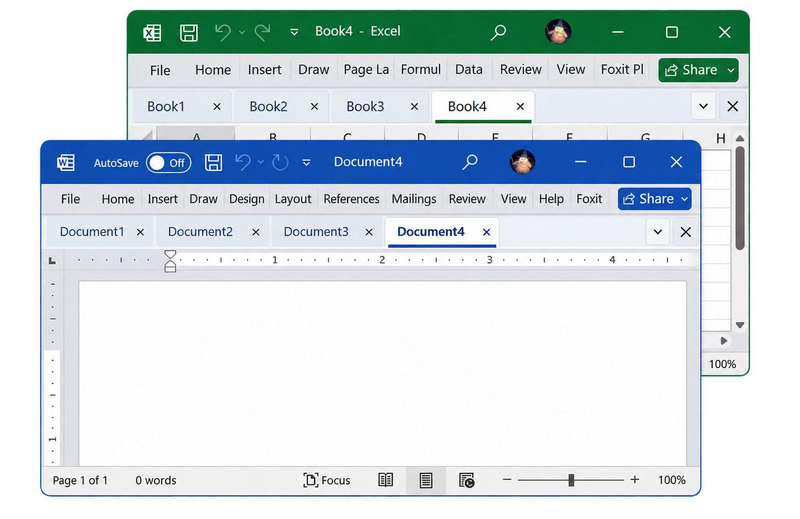

# OfficeTabs

Document tabs for Microsoft Word and Excel on Windows, written in Rust.



OfficeTabs is a COM add-in that draws its own strip above the document area, so every open
document becomes a tab in the same window. Tabs shrink as you open more of them, drag to
reorder, and can be pulled out into a separate window and dragged back.

This is an early preview. Try it on documents you can afford to lose, and keep
backups of anything that matters.

## What it does

- One tab per open document, with a close button and scroll arrows once the strip is full.
- Drag a tab to reorder it. Drag it away from the strip to detach the document, then drag it
  back to re-dock; a preview shows where it will land.
- Close all asks first, and Office's own save prompt still decides what happens to unsaved
  work.
- Manager switches tabs on or off for Word and Excel, and resets their settings.
- No account, no telemetry, no activation. Everything stays on your machine.

## Install

1. Download `OfficeTabs-Rust-<version>-Setup.exe` from Releases.
2. Close Word and Excel. Setup offers to close them, but it never kills a process, so they
   still ask you to save first.
3. Run Setup. No administrator rights needed. Reopen Office and tabs are there.

The installer is not code-signed, so Windows SmartScreen will ask for confirmation. It
installs for the current user only, under `%LOCALAPPDATA%\Programs\OfficeTabs`.

## Requirements

- Windows 10 or 11, 64-bit.
- 64-bit desktop Word or Excel. 32-bit Office, PowerPoint, Office for Mac and Office on the
  web are not supported.
- Tabs live inside one Office process. A document opened in a second process (another Word
  instance, for example) gets its own group, and tab order is not remembered between
  sessions.

## Build

You need Rust with the MSVC x64 toolchain (any recent stable), the Visual Studio 2022 C++
build tools and a Windows 10/11 SDK for `link.exe`, `rc.exe` and `makecab`, Windows
PowerShell, and Python 3.11 or newer. Office is not needed, and `Cargo.lock` is committed.

```powershell
./scripts/build.ps1
```

One command: `cargo test --release`, builds the DLL, Manager and setup, authors the MSI,
embeds it in `setup.exe`, runs the three audits and prints the SHA-256. The result is one
file, `target/OfficeTabs-Rust-<version>-Setup.exe`; intermediates go to `%TEMP%` and are
deleted, so there is no `dist/`. If `rc.exe` resolves to the wrong SDK, set `RC_EXE`.

## License

MIT, see [LICENSE.txt](LICENSE.txt). OfficeTabs is an independent project. Word, Excel and
Windows are named only to describe compatibility.
